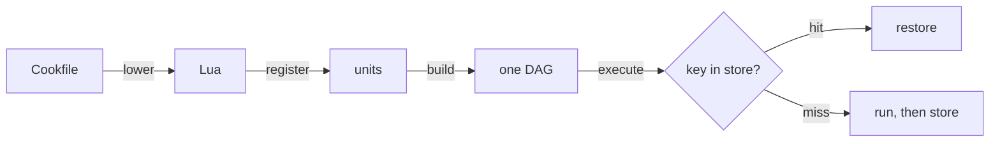

A Cookfile is a declaration. Nothing in it runs until cook has lowered it to Lua, registered every unit, and built one graph from the declared ordering. This eighteen-second simulation shows the four stages on one small build.

<video src="/graphics/cook-pipeline/cook-pipeline.mp4" controls muted loop playsinline preload="metadata" aria-label="Animation: a Cookfile lowered to Lua, registered as units, built into one graph and executed with cache checks" />

## The four stages

1. **Lower.** Every Cookfile becomes Lua before it runs. `cook emit-lua` shows you exactly what yours compiles to; see [[10. Dropping into Lua]].
2. **Register.** The Lua registers units: each has declared inputs, outputs, and the determinants you sealed into its key.
3. **Build the graph.** Edges come from declared ordering and from `$<recipe>` references ([[4. Connecting recipes]]). Independent nodes can run together.
4. **Execute what is ready.** Every ready unit checks the cache first. Only the misses reach the workers, and every miss has a printed cause ([[9. Caching and cache trust]]).

> [!note] Illustrative
> The timing in the clip is simulated. The terminal replays elsewhere in these docs are real recordings.
